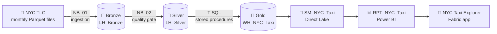

# 🚕 NYC Yellow Taxi 2025 · End-to-End Analytics Platform on Microsoft Fabric

[](https://github.com/abdoulhamiddiallo/NYC-Taxi-End-To-End-Project/actions/workflows/checks.yml)


---

> 💡 **A production-grade data platform, from 48.7 million raw taxi records to an interactive app for decision makers.**
> ✨ *Every record is checked, every month is reconciled, every number on screen can be traced back to its source.*

---

## 📊 Dashboard Preview


---

## 📈 Key Results

- 🚕 **45.5 million trips** analysed across the twelve months of 2025, about **124,700 trips a day**
- 💰 **$1.31 billion** of revenue, **$28.78** paid per trip on average
- 🛡️ **48.7 million records** checked against **10 quality rules**, **3.19 million** isolated with the reason they failed
- ✅ **12 of 12 months reconciled**: every accepted record reaches the warehouse, not one more, not one less
- 🏙️ **86.3 %** of pickups happen in Manhattan
- ✈️ Airports generate **8.7 %** of trips but **23.8 %** of revenue
- 🚦 **6 pm** is the peak hour, with **8,875 pickups a day**
- 🏛️ **$24.9 million** collected by the new Manhattan congestion relief fee since **5 January 2025**

---

## 🚀 Business Impact

👉🏾 Gives decision makers **one trusted view** of demand, revenue, payments and congestion fees for the whole year

👉🏾 Shows **where and when** demand peaks, to place vehicles at the right zone and at the right hour

👉🏾 Measures the first year of the **congestion relief fee**, month by month

👉🏾 Proves the **quality of the data** with a dedicated page: every rejected record and every reconciled month is visible

👉🏾 Builds a **scalable foundation**: a new month is loaded by running one pipeline with one parameter

---

## 🧭 Executive Summary

This project delivers a **complete end-to-end analytics platform** on **Microsoft Fabric**. It turns the raw trip files
published by the NYC Taxi and Limousine Commission into an **interactive Fabric app** used by business users.

👉🏾 Full data lifecycle:

**TLC files → Data Pipeline → Bronze Lakehouse → PySpark Silver → Gold Warehouse → Semantic Model → Power BI → Fabric App**

---

## ⚙️ Data Pipeline (Metadata-Driven Ingestion)


`PL_01_NYC_Taxi_Medallion` runs the whole platform for **any list of months**: it lands and cleanses four months in
parallel, refreshes the SQL endpoint, loads the dimensions, then loads and reconciles the facts month by month before
rebuilding the aggregates and the optimiser statistics.

| Pipeline | Role |
|----------|------|
| `PL_00_Build_Warehouse` | Creates the warehouse: schemas, tables and stored procedures |
| `PL_01_NYC_Taxi_Medallion` | Runs the medallion flow, parameters `year`, `months`, `force_download`, `parallel_months` |
| `PL_02_Deploy_Report` | Generates the Power BI report as code and deploys it |
| `PL_03_Refresh_Serving_Layer` | Redeploys the stored procedures and rebuilds the aggregates without reloading the facts |

---

## 🔗 Data Lineage (End-to-End)


👉🏾 This view shows the full flow inside the Fabric workspace:

Lakehouses → Notebooks → Pipelines → Warehouse → Semantic Model → Report → Fabric App

👉🏾 It provides:
- full **traceability** from every visual back to the source files
- the **dependencies** between items, so the impact of a change is known before it is made
- a clear picture of the **end-to-end architecture**

---

## 🧱 Data Architecture (Medallion)



| Layer | Fabric item | What happens |
|-------|-------------|--------------|
| 🥉 Bronze | Lakehouse `LH_Bronze` | The 12 monthly files and the zone reference land exactly as published, with size, SHA-256 fingerprint and HTTP date recorded in an ingestion log |
| 🥈 Silver | Lakehouse `LH_Silver` | PySpark enforces a schema contract, removes exact duplicates, runs 10 quality rules, isolates failing records in a quarantine table and computes the GPS centre of every taxi zone |
| 🥇 Gold | Warehouse `WH_NYC_Taxi` | T-SQL stored procedures load a star schema month by month inside a transaction, reconcile the row counts and build serving aggregates |
| 🧩 Semantic | `SM_NYC_Taxi` | Direct Lake model: 15 tables, 11 relationships, 117 DAX measures |
| 📊 Report | `RPT_NYC_Taxi` | 5 pages and 104 visuals, generated as code in the PBIR format |
| 📱 App | `NYC Taxi Explorer` | Fabric org app that delivers the report to business users |

---

## 🛡️ Data Quality and Trust

| | Rows | Share |
|---|---:|---:|
| Records read from the 12 TLC files | 48,722,602 | 100.00 % |
| Exact duplicates removed | 1 | 0.00 % |
| Records accepted | 45,531,235 | 93.45 % |
| Records quarantined, each with its failed rules | 3,191,366 | 6.55 % |

👉🏾 **No silent row drops.** A record that fails a rule is never deleted: it is kept in a quarantine table with the
list of the rules it failed.

👉🏾 **Reconciliation as a gate.** For every month, the Silver, staging and fact counts must match, otherwise the
pipeline stops.

👉🏾 **Visible to everyone.** The Pipeline and Quality page of the report shows the rules, the rejected records and the
reconciliation of each month.

Rule by rule and month by month results: [docs/data-quality.md](docs/data-quality.md)

---

## 🗂️ Data Model


A **star schema** with one fact table at the grain of one trip (`fact.fact_trip`, 45.5 million rows) and eight
dimensions: date with US federal holidays, hour and part of the day, pickup zone, dropoff zone, vendor, rate code,
payment type and distance band. The **Direct Lake** model reads the warehouse tables directly, with no import and no
scheduled refresh.

Details: [docs/data-model.md](docs/data-model.md) · all 117 measures with their DAX: [docs/measures.md](docs/measures.md)

---

## 📊 The Report

Five pages, each one answering a business question. Every page filters by **month** and by **type of day** (weekday,
weekend, holiday), and every KPI comes with a line of context that follows the filters.

| | |
|---|---|
|  **⏰ When New York rides.** Weekday by hour heatmap, parts of the day, hourly profile by type of day, seasonality |  **📍 Where New York rides.** Pickup map, busiest routes, borough to borough matrix |
|  **💳 What New York pays.** Revenue mix, payment methods, tips by hour, distance bands, congestion fees |  **🛡️ Behind the numbers.** Quality gate, reasons for quarantine, reconciliation, run log |

Page by page details: [docs/report.md](docs/report.md)

---

## 🧠 Business Insights

👉🏾 **Airports are the most valuable rides.** Airport trips are fewer than one in eleven, yet they bring in almost a
quarter of all revenue ($312 million).

👉🏾 **Short trips make the volume, long trips make the money.** Trips under 2 miles are **53 %** of all rides but
**34 %** of revenue, while trips over 10 miles are **8 %** of rides and **22 %** of revenue.

👉🏾 **The Upper East Side is the heart of the yellow cab.** It holds the busiest pickup zone and the busiest dropoff
zone of the city, and the busiest single route of the year runs from Upper East Side South to Upper East Side North: **297,441 trips**, 7.7 minutes and
$8.86 on average.

👉🏾 **The city never sleeps on weekends.** On Friday and Saturday nights, pickups at midnight reach up to **3.7 times**
the level of a Monday at the same hour.

👉🏾 **Tips follow the clock.** Card tips fall to **17.0 %** of the fare at 5 am and climb to **23.6 %** at 6 pm.

👉🏾 **Fares rose through the year.** The average fare went from **$17.97 in January** to **$22.63 in December**
(+26 %), and December was the best month of the year with **$132.9 million** of revenue.

👉🏾 **Payments are going digital.** **67.8 %** of trips are paid by card and **21.0 %** use the flex fare, against
**9.6 %** in cash.

---

## 📱 The Fabric App


**NYC Taxi Explorer** puts the report in the hands of business users: one navigation pane for the five pages and a dark
theme matching the report. The app reads the live report, so every new deployment reaches its audience immediately.

---

## 🛠️ Engineering Highlights

👉🏾 **Idempotent at every step.** A file already landed with the same fingerprint is skipped, Silver rewrites only the
month it processes, Gold reloads a month inside one transaction. Any month can be replayed safely.

👉🏾 **Deterministic keys.** Trip keys are built from the month and a stable sort, so a replayed month keeps the same
keys.

👉🏾 **Spark and SQL in step.** The Silver SQL endpoint is refreshed through the Fabric REST API before the warehouse
reads new data.

👉🏾 **Geography without extra libraries.** The taxi zone shapefile is read in pure Python and converted from the New
York State Plane projection to GPS coordinates, matching the reference library pyproj to 13 decimal places.

👉🏾 **Fast by design.** Serving aggregates, V-Order Delta files, statistics on the join keys and a Direct Lake model
keep every visual instant on 45 million rows.

👉🏾 **Everything as code.** The pipelines, the semantic model and the report are generated by Python. On every push,
[`tools/check_repo.py`](tools/check_repo.py) regenerates them in GitHub Actions and checks that the committed files
match, that every field used by the report exists in the model and that every visual fits its page.

---

## 🧰 Tech Stack

| Area | Tools |
|------|-------|
| Platform | Microsoft Fabric (Lakehouse, Warehouse, Data Pipelines, Notebooks, Org Apps) |
| Data engineering | PySpark, Delta Lake, V-Order |
| Warehousing | T-SQL stored procedures, star schema, serving aggregates |
| Semantic layer | Direct Lake, TMDL, DAX |
| Visualisation | Power BI, PBIR, Azure Maps |
| Automation | Fabric REST API, Python, GitHub Actions |

---

## 🎯 Skills Demonstrated

- Medallion architecture design on Microsoft Fabric
- Metadata driven, parameterised and idempotent pipelines
- Data quality engineering: rules, quarantine, logging and reconciliation
- Dimensional modelling and T-SQL development
- Semantic modelling and advanced DAX
- Executive dashboard design and storytelling with data
- Deployment as code and continuous verification

---

## 📂 Repository Structure

```
config/          workspace and item ids used by the generators
notebooks/       NB_01 ingestion, NB_02 Bronze to Silver, NB_03 report deployment
pipelines/       pipeline generator and the four pipeline definitions
warehouse/       schemas, tables and stored procedures (T-SQL)
semantic-model/  model generator and the TMDL semantic model
report/          report generator and the PBIR report
tools/           repository checks and documentation generator
docs/            architecture, data quality, data model, measures, report, runbook, images
```

---

## ▶️ How to Run

1. Run `PL_00_Build_Warehouse` once
2. Run `PL_01_NYC_Taxi_Medallion` (all of 2025 by default, or any list of months)
3. Run `PL_02_Deploy_Report`
4. Open the **NYC Taxi Explorer** app

```bash
python tools/check_repo.py    # regenerate and verify every artefact
```

Operations and deployment to a new workspace: [docs/runbook.md](docs/runbook.md)

---

## 📚 Documentation

| Page | Content |
|------|---------|
| [Architecture](docs/architecture.md) | Layers, pipelines, engineering choices |
| [Data quality](docs/data-quality.md) | The 10 rules, results by rule and by month, reconciliation |
| [Data model](docs/data-model.md) | Star schema, semantic model tables and relationships |
| [Measures](docs/measures.md) | The 117 DAX measures with their definitions |
| [Report](docs/report.md) | The five pages and their design |
| [Runbook](docs/runbook.md) | Operations and deployment |

---

## 📄 Data Source

[NYC Taxi and Limousine Commission, trip record data](https://www.nyc.gov/site/tlc/about/tlc-trip-record-data.page):
yellow taxi trips from January to December 2025, with the TLC taxi zone lookup and shapefile. Cash tips are not
recorded by the TLC, so tip figures cover card payments.

---

## 🏁 Conclusion

👉🏾 This project demonstrates a **real-world modern data platform** on Microsoft Fabric: reliable ingestion, a quality
gate that never loses a record, a reconciled warehouse, a semantic model built for speed and an app that puts the
answers in the hands of decision makers.

---

## 👤 Author

**Abdoul Hamid Diallo** · Microsoft Fabric Data Engineer

[LinkedIn](https://www.linkedin.com/in/abdoul-hamid-diallo-fabric-data-engineer/) ·
Microsoft Certified: Fabric Data Engineer Associate (DP-700), Fabric Analytics Engineer Associate (DP-600),
Power BI Data Analyst Associate (PL-300)

---

## ⭐ Final Thought

Millions of rows only matter once people can trust them and act on them. That is what this platform is built for.
