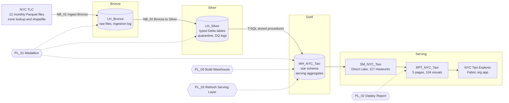
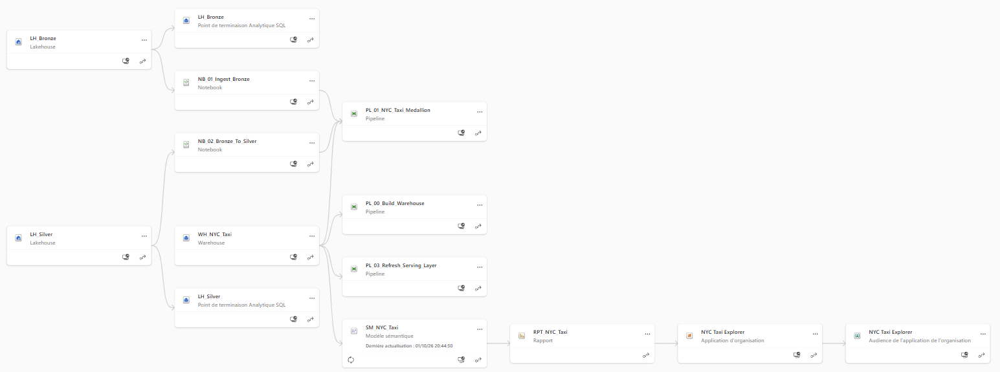
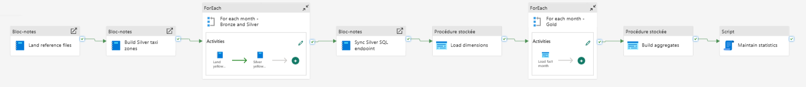
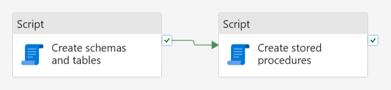
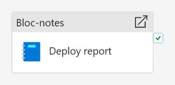
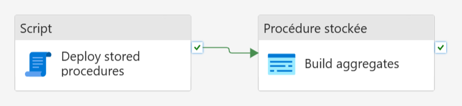

# Architecture

The platform follows the medallion pattern on Microsoft Fabric. Every item is defined as code in this repository and
deployed through the Fabric REST API.

## Layers

| Layer | Item | Content | Written by |
|-------|------|---------|------------|
| Bronze | `LH_Bronze` | `Files/raw/yellow/year=YYYY/month=MM/` monthly Parquet files byte for byte as published, `Files/raw/reference/` zone lookup CSV and shapefile, Delta table `bronze_ingestion_log` (size, SHA-256, HTTP `Last-Modified`, run id) | `NB_01_Ingest_Bronze` |
| Silver | `LH_Silver` | `silver_yellow_trips` (partitioned by year and month, V-Order), `silver_yellow_trips_rejected` (quarantine with the failed rules of each row), `silver_taxi_zones` (with WGS84 centroids), `silver_dq_log`, `silver_dq_rule_log` | `NB_02_Bronze_To_Silver` |
| Gold | `WH_NYC_Taxi` | Schemas `stg` (staging), `dim` (8 dimensions), `fact` (`fact_trip`), `agg` (7 serving aggregates), `etl` (`run_log`, `load_control`) | Stored procedures in `warehouse/02_procedures.sql` |
| Semantic | `SM_NYC_Taxi` | Direct Lake model on the warehouse: 15 tables, 11 relationships, 117 measures | `semantic-model/gen_model.py` |
| Report | `RPT_NYC_Taxi` | 5 pages of 1600 x 900, 104 visuals, PBIR format | `report/gen_report.py`, deployed by `NB_03_Deploy_Report` |
| App | `NYC Taxi Explorer` | Fabric org app: the report with its five pages in one navigation pane, dark theme | Fabric app editor |

## Pipelines

**PL_01_NYC_Taxi_Medallion** runs the whole flow. Parameters: `year`, `months` (array), `force_download`,
`parallel_months`. Bronze and Silver run four months in parallel; the Gold load is sequential so that every month is
reconciled before the next one starts.

| Pipeline | Activities | When to run it |
|----------|-----------|----------------|
| `PL_00_Build_Warehouse` | Create schemas and tables, create stored procedures | Once for a new workspace. It drops and recreates every warehouse table, so PL_01 must run afterwards |
| `PL_01_NYC_Taxi_Medallion` | Land reference files, Silver taxi zones, for each month (land, Silver), sync the Silver SQL endpoint, load dimensions, for each month (Gold load with reconciliation), build aggregates, maintain statistics | For a full load, or with a subset of months for an incremental load |
| `PL_02_Deploy_Report` | Runs `NB_03_Deploy_Report` | After any change to the report generator |
| `PL_03_Refresh_Serving_Layer` | Redeploys the stored procedures, rebuilds the aggregates | After a change to a stored procedure, without reloading 46 million facts |

| PL_00 | PL_02 | PL_03 |
|-------|-------|-------|
|  |  |  |

## Engineering choices

**Idempotence at every hop.** A month that is already landed with the same size and hash is skipped. The Silver write
is a `replaceWhere` overwrite of the month partition. The Gold load deletes and reloads the month inside one
transaction. Any month can therefore be replayed any number of times without duplicates.

**Deterministic keys.** `trip_sk` is `year * 10^10 + month * 10^8 + row number` after a stable sort, so a replayed month
gets the same keys and the fact table never drifts.

**No silent row drops.** Ten quality rules are evaluated on every row. A row that fails any rule goes to the quarantine
table with the list of its failed rules, and the counts are logged per rule and per month. See
[data quality](data-quality.md).

**Reconciliation as a gate.** After each monthly Gold load, `etl.usp_load_month` compares the Silver, staged and fact
row counts. A mismatch raises error 50020 and stops the pipeline; a match is recorded in `etl.load_control`.

**No race between Spark and the warehouse.** The Silver SQL analytics endpoint is refreshed explicitly through the REST
`refreshMetadata` call before the warehouse reads the new Delta files.

**Serving aggregates.** Monthly KPIs, the weekday by hour profile, zone to zone flows and data quality snapshots are
precomputed by `etl.usp_build_aggregates`, which keeps the heaviest visuals instant.

**Zone centroids without geospatial libraries.** `NB_02` reads the TLC
shapefile with a pure Python reader and converts the EPSG:2263 coordinates (New York Long Island, US feet) to WGS84
with the inverse Lambert conformal conic projection. `notebooks/zone_centroids.py` is the standalone version, validated
against pyproj to within 1e-13 degree.

**Report as code.** The semantic model and the report are generated from Python. Layout, measures, colours and number
formats are reviewed in diffs and redeployed identically to any workspace. `tools/check_repo.py` regenerates everything
on each push and fails when a committed file differs from what the generators produce.
