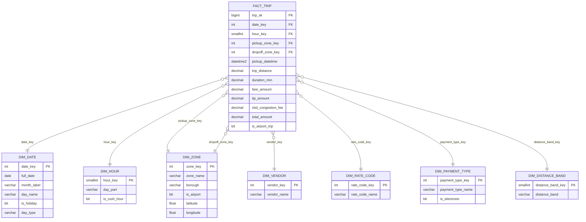
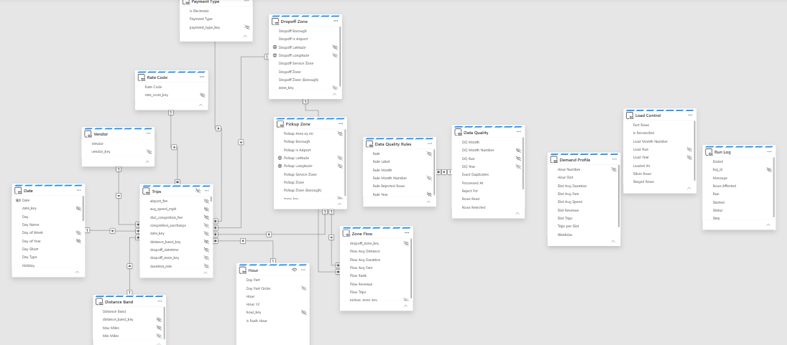

# Data model

## Gold star schema (`WH_NYC_Taxi`)

The grain of `fact.fact_trip` is one valid taxi trip. Vendor, rate code, payment type and zone codes that the TLC data
dictionary does not list are mapped to an `Unknown` member, so a trip never loses its row because of an unexpected code.

| Schema | Tables | Role |
|--------|--------|------|
| `stg` | `stg_yellow_trips`, `stg_taxi_zones` | One month at a time, replaced on each load |
| `dim` | `dim_date` (2024 to 2026 calendar with US federal holidays and day type), `dim_hour` (day parts, rush hours 7 to 10 am and 4 to 7 pm), `dim_zone` (TLC taxi zones with centroids, plus an Unmapped member), `dim_vendor`, `dim_rate_code`, `dim_payment_type`, `dim_distance_band` | Conformed dimensions, loaded by `etl.usp_load_dimensions` |
| `fact` | `fact_trip` (45,531,235 rows, 30 columns) | Loaded month by month by `etl.usp_load_month` |
| `agg` | `monthly_kpi`, `daily_borough`, `hourly_weekday`, `zone_flow`, `zone_monthly`, `dq_month`, `dq_rule_month` | Serving aggregates, rebuilt by `etl.usp_build_aggregates` |
| `etl` | `run_log`, `load_control` | Step log of every procedure and reconciliation status of every month |

Primary keys are declared `NOT ENFORCED` for the optimiser, and the pipeline maintains statistics on the fact join keys.

## Semantic model (`SM_NYC_Taxi`)

A Direct Lake model on the warehouse tables. Relationships are single direction, many to one, and declared with
`relyOnReferentialIntegrity`: the reconciliation step guarantees the keys, so Direct Lake can use inner joins.

| Model table | Source | Role |
|-------------|--------|------|
| `Trips` | `fact.fact_trip` | Fact table, hidden; carries the 117 measures |
| `Date`, `Hour` | `dim.dim_date`, `dim.dim_hour` | Calendar, day type, hour and day part |
| `Pickup Zone`, `Dropoff Zone` | `dim.dim_zone` (role playing) | Zone, borough, airport flag, centroid for the map |
| `Vendor`, `Rate Code`, `Payment Type`, `Distance Band` | `dim.*` | Descriptive dimensions |
| `Zone Flow` | `agg.zone_flow` | Ranked origin to destination pairs |
| `Demand Profile` | `agg.hourly_weekday` | Weekday by hour profile |
| `Data Quality`, `Data Quality Rules` | `agg.dq_month`, `agg.dq_rule_month` | Quality gate results |
| `Load Control`, `Run Log` | `etl.load_control`, `etl.run_log` | Reconciliation and run history |

| From | To |
|------|----|
| `Trips[date_key]` | `Date[date_key]` |
| `Trips[hour_key]` | `Hour[hour_key]` |
| `Trips[pickup_zone_key]` | `Pickup Zone[zone_key]` |
| `Trips[dropoff_zone_key]` | `Dropoff Zone[zone_key]` |
| `Trips[vendor_key]` | `Vendor[vendor_key]` |
| `Trips[rate_code_key]` | `Rate Code[rate_code_key]` |
| `Trips[payment_type_key]` | `Payment Type[payment_type_key]` |
| `Trips[distance_band_key]` | `Distance Band[distance_band_key]` |
| `Zone Flow[pickup_zone_key]` | `Pickup Zone[zone_key]` |
| `Zone Flow[dropoff_zone_key]` | `Dropoff Zone[zone_key]` |
| `Data Quality Rules[Rule Month]` | `Data Quality[DQ Month]` |

The full list of measures, with their DAX, is in [measures.md](measures.md).
