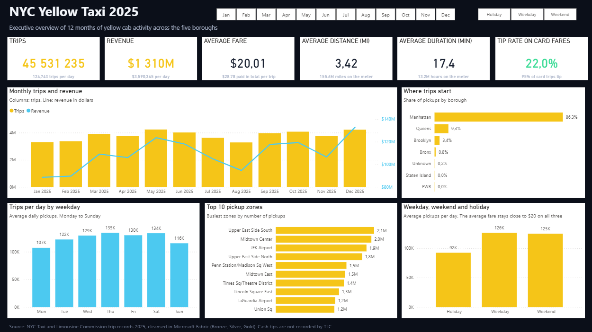
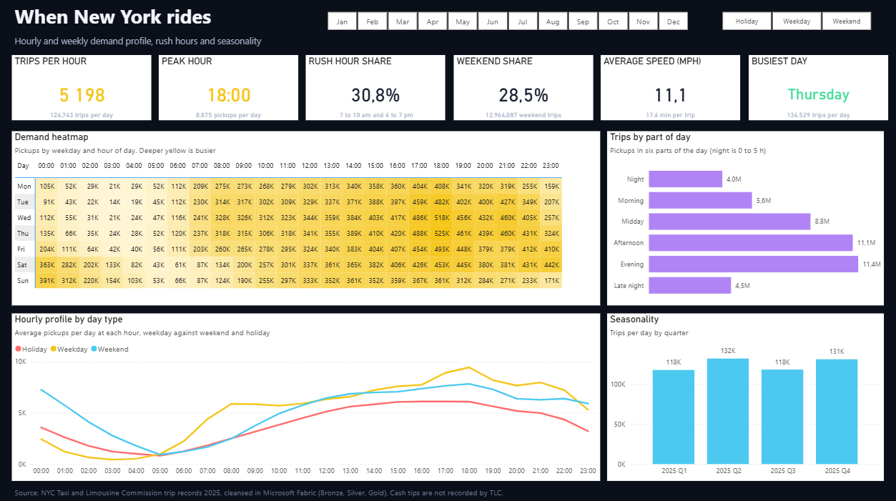
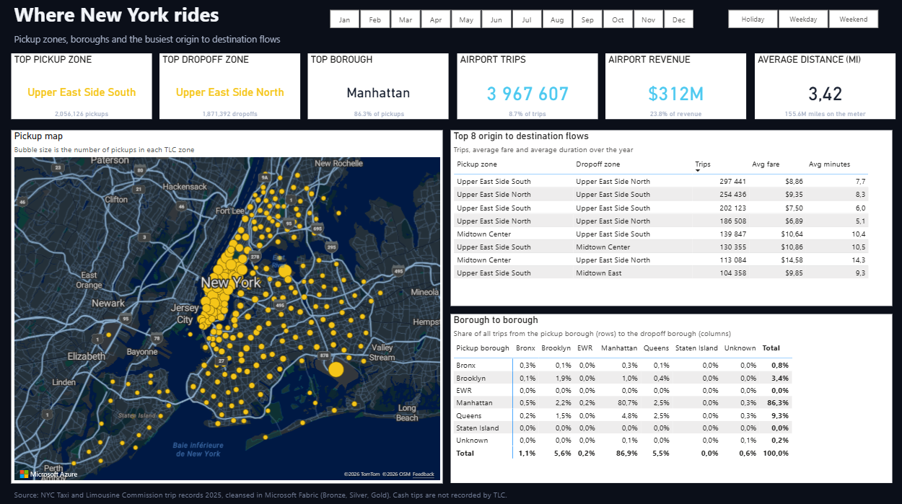
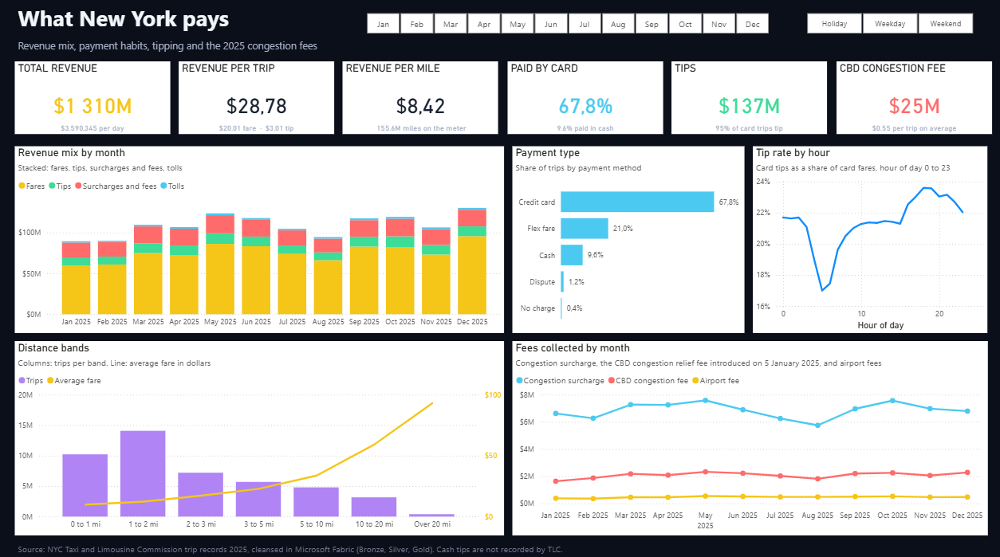
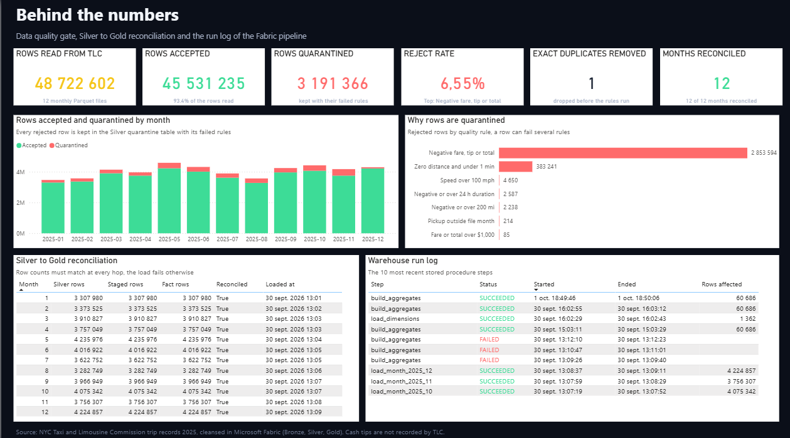
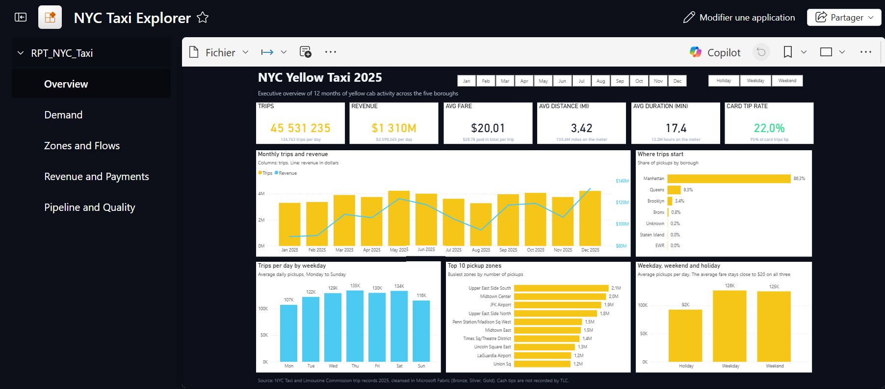

# Power BI report

`RPT_NYC_Taxi` has five pages of 1600 x 900 in a dark theme with a taxi yellow accent. Every page except the last one
carries the same two button slicers, month and day type (weekday, weekend, holiday), and every KPI card has one line of
context under its value. The report is generated by `report/gen_report.py` and deployed by `PL_02_Deploy_Report`.

## Overview

The year in six numbers, the monthly trend of trips and revenue, where trips start, the weekly rhythm, the ten busiest
pickup zones and the difference between weekdays, weekends and holidays.

## Demand

When New York rides: a weekday by hour heatmap of pickups, the six parts of the day, the hourly profile of weekdays,
weekends and holidays, and the seasonality by quarter. The peak is 6 pm, with 8,875 pickups per day on average.

## Zones and Flows

Where New York rides: an Azure Maps bubble map of pickups per TLC zone (centroids computed in Silver), the eight busiest
origin to destination pairs and the borough to borough matrix. Airports account for 8.7 % of trips and 23.8 % of
revenue.

## Revenue and Payments

What New York pays: the revenue mix by month, payment methods, the tip rate by hour, fares by distance band and the
fees collected each month, including the CBD congestion relief fee introduced on 5 January 2025.

## Pipeline and Quality

Behind the numbers: rows read, accepted and quarantined, the reasons for quarantine, the Silver to Gold reconciliation
of each month and the ten most recent steps of the warehouse run log.

## Design rules

- One accent per meaning: yellow for volume and money, green for good outcomes, coral for fees and rejects, cyan for
  airports and cards.
- No axis title repeats what the visual subtitle already says, and no technical field name reaches the reader.
- No scrollbar and no truncated label at 1600 x 900: tables show every row, long zone names get a wider category
  margin, and the run log keeps the ten latest steps.
- Shares split very unevenly (86 % Manhattan) are drawn as sorted bars rather than donuts.
- Every number in a context line is a measure, so it follows the slicers.

## The Fabric app

`NYC Taxi Explorer` is a Fabric org app: it shows the report with its five pages in one navigation pane, under a dark
app theme that matches the report. An org app reads the live report, so a redeployment through `PL_02_Deploy_Report`
reaches its audience at once.
